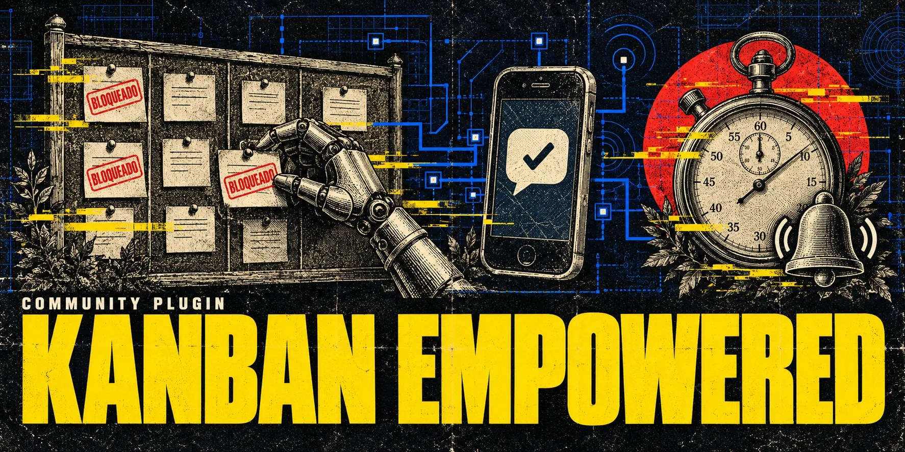

# kanban-empowered



A plugin for [Hermes Agent](https://github.com/NousResearch/hermes-agent) that extends the native
kanban for a fleet of agent profiles:

- **Human waits (Telegram).** A card blocked on a person gets a reminder after 30 min and 2 h, an
  escalation after 8 h and a daily digest after that. The owner answers the reminder on Telegram,
  naming the item (`1 — conectei`, `3 — A`, or free text), or runs
  `hermes kanban-empowered done <card>`, and the card is unblocked.
  When the reminder layout changes in a new plugin version, every open wait is sent once more in
  the new layout (its stage is not advanced). A wait that holds other cards can get its digest on
  its own cadence (`waits.blocking_digest_every`), and when a wait reaches the escalation with no
  `escalate_to` configured, the owner gets one setup alert saying so.
- **Stuck cards.** Cards held by Hermes' respawn guard (`active_pr`, `blocker_auth`) for more than
  30 min are reported to the owner, with a one-line command to hand them to another profile.
- **Infrastructure failures.** When Hermes' failure breaker parks a card only because the host
  failed (gateway, worker persistence), the plugin undoes the park, within a budget of 2 undos per
  card per 24 h. A burst of 3 infrastructure exits within 1 h raises one systemic alert.
- **Visibility.** `explain` says why a card is (not) moving, `status` lists the fleet, and a pinned
  Telegram message (the live panel) is kept up to date. `status --watch` shows the same panel in
  the terminal.

The plugin coexists with Hermes' own notifier: it never repeats the native completed, blocked,
gave_up, crashed, review or block_loop_detected messages.

**Status:** v0.1.

## Requirements

- Hermes Agent at revision `bf0203a794` (the revision this version was written and tested
  against; `doctor` prints both `hermes_compat` and the installed `hermes_head`), with the kanban
  enabled.
- Optional: the core patch [`patches/0001-kanban-veto-hooks.patch`](patches/README.md). It adds the
  `kanban_pre_claim` and `kanban_pre_complete` veto hooks. **v0.1 does not use them yet**: the
  patch is inert and the plugin behaves the same with or without it. Without the patch, `doctor`
  reports `veto_hooks: missing` and the coordinator warns once (log and Telegram).
- Python standard library only (no extra dependencies).

## Install

Step-by-step guide with verification and rollback: [`docs/INSTALL.md`](docs/INSTALL.md). Live acceptance results of v0.1: [`docs/ACCEPTANCE-v0.1.md`](docs/ACCEPTANCE-v0.1.md).

Plugins, their state and their settings are per Hermes profile. Install and enable the plugin in
**every profile that runs kanban workers** (builder, devops, reviewer, ...) and in the profile of
the gateway that acts as the coordinator (by default `default`).

For each profile:

1. Put this repository in the profile's plugin directory, `<profile home>/plugins/kanban-empowered/`
   (`~/.hermes/plugins/kanban-empowered/` for `default`,
   `~/.hermes/profiles/<name>/plugins/kanban-empowered/` for a named profile).
   `hermes plugins install <git url>` does the same.
2. Enable it: `hermes plugins enable kanban-empowered` (it goes into `plugins.enabled`).
3. Add the settings below to that profile's `config.yaml`. Every profile must agree on
   `coordinator_profile` and `shared_state_dir` (the default `shared_state_dir` is derived from
   `coordinator_profile`, so leaving both at their defaults everywhere is consistent).
4. Run `hermes kanban-empowered doctor` in that profile.

What runs where:

- **Every profile** registers the worker guard (`pre_tool_call`): a `kanban_block` that waits on a
  person must carry a structured ask (`Need:` / `Why:` / `How to reply:`, or the pt-BR labels
  `Preciso:` / `Por quê:` / `Como responder:`), otherwise the agent is asked to redo the block.
  Optional lines: `Subject:` / `Assunto:`, `Next step:` / `Próximo passo:` and `Options:` /
  `Opções:` followed by one `A — choice` line per option.
  Worker profiles open no plugin state.
- **The coordinator profile** (only) opens the shared state, evaluates the boards on Hermes'
  dispatch tick (at most every 30 s), sends Telegram messages, reads the Telegram replies and
  records worker exits. A leader lock in `shared_state_dir` makes sure only one coordinator
  process acts at a time; a second one stays passive.

## Configuration

Settings live under `plugins.entries.kanban-empowered.settings`:

```yaml
plugins:
  entries:
    kanban-empowered:
      settings:
        mode: enforce                 # enforce | cooperative-only
        # language: pt                # plugin messages' language; default: follow Hermes
        coordinator_profile: default  # the profile whose gateway is the coordinator
        # shared_state_dir: C:/Users/me/AppData/Local/hermes/plugin-data/kanban-empowered
        telegram:
          owner_ids: { sponsor: 6802889854, ops: 5550001 }
          pin_live_panel: true
          reply_ttl: 7d
        waits:
          default_owner: sponsor
          reminders: [30m, 2h]
          escalate_after: 8h
          escalate_to: ops
          digest: daily
          human_kinds: [needs_input]
          require_structured_ask: true
        boards:
          side-project:
            waits: { default_owner: ops }
        guards:
          alert_after: 30m
        infra_failures:
          undo_budget: { count: 2, window: 24h }
          alert_count: 3
          alert_window: 1h
          # patterns: ["Kanban execution unknown", "retained by owner",
          #            "Gateway connection failed", "WorkerPersistenceError"]
```

| Key | Default | Meaning |
|---|---|---|
| `mode` | `enforce` | `enforce` or `cooperative-only`. Validated, but without effect in v0.1 (it is for the veto hooks). |
| `language` | none | Language of the plugin's messages (`pt`, `en`, ...). None follows the Hermes language. |
| `coordinator_profile` | `default` | The profile whose process acts as the coordinator. |
| `shared_state_dir` | the coordinator profile's `plugin-data/kanban-empowered` | The plugin's SQLite state and leader lock, shared by all profiles. Default: `<hermes root>/plugin-data/kanban-empowered` when `coordinator_profile` is `default`, else `<hermes root>/profiles/<coordinator_profile>/plugin-data/kanban-empowered`. **Must be on a local NTFS (or other local) disk**: the leader lock relies on hard links and atomic renames, which network shares and some sync folders do not provide. |
| `telegram.owner_ids` | `{}` | Owner name to Telegram id. **Each value is BOTH the person's Telegram user id and the id of their private chat with the bot** (in a Telegram DM they are the same number): messages go to that chat, and a reply is accepted only from that user. |
| `telegram.pin_live_panel` | `true` | Keep a pinned live panel in the default owner's chat. |
| `telegram.reply_ttl` | `7d` | How long a reminder can still be answered. |
| `waits.default_owner` | `sponsor` | Owner of the waits on any board without an override. |
| `boards.<board>.waits.default_owner` | | Per-board owner. |
| `waits.reminders` | `[30m, 2h]` | Reminder times, counted from the start of the block. |
| `waits.escalate_after` | `8h` | When the escalation goes out (to the owner, plus a copy to `escalate_to`). |
| `waits.escalate_to` | none | Owner name that receives a read-only copy of escalations. It cannot resolve them. |
| `waits.digest` | `daily` | Repeat interval after the escalation (`hourly`, `daily`, `weekly` or a duration). |
| `waits.blocking_digest_every` | same as `waits.digest` | Digest interval for waits that hold other cards back (`hourly`, `daily`, `weekly` or a duration like `6h`). Empty = the same as `waits.digest`. |
| `waits.human_kinds` | `[needs_input]` | Block kinds that wait on a person (an untyped block counts too). |
| `waits.require_structured_ask` | `true` | The worker guard requires the three-line ask. |
| `guards.alert_after` | `30m` | How long a respawn guard may hold a card before the owner is told. |
| `infra_failures.undo_budget` | `{count: 2, window: 24h}` | Breaker parks undone per card per window. |
| `infra_failures.alert_count` / `alert_window` | `3` / `1h` | Systemic alert threshold. |
| `infra_failures.patterns` | see above | Error substrings that mark a worker failure as the host's. |

Durations accept `s`, `m`, `h`, `d` (`30m`, `2h`, `7d`) or plain seconds.

The Telegram bot token is read from the `TELEGRAM_BOT_TOKEN` environment variable of the
coordinator process (the same bot the gateway already uses). The plugin only calls `sendMessage`,
`editMessageText` and `pinChatMessage`; it never polls the bot.

## Settings screen

In Hermes Desktop the plugin has a settings form (Capabilities, plugin gear, or Settings > Plugins),
generated from the `config_schema` in [`plugin.yaml`](plugin.yaml). It edits the common keys:

| Form field | Same as in `config.yaml` |
|---|---|
| Message language | `language` |
| Mode | `mode` |
| Owner Telegram id | `telegram.owner_ids.<default owner>` |
| Default owner | `waits.default_owner` |
| Reminders (`30m,2h`) | `waits.reminders` |
| Escalate after | `waits.escalate_after` |
| Digest every | `waits.digest` |
| Digest every (waits that block cards) | `waits.blocking_digest_every` |
| Escalate to | `waits.escalate_to` |
| Require structured ask | `waits.require_structured_ask` |
| Pin live panel | `telegram.pin_live_panel` |
| Stuck-card alert after | `guards.alert_after` |
| Infra undo budget / window | `infra_failures.undo_budget.count` / `.window` |
| Show the sidebar menu | `show_sidebar_menu` (Desktop dashboard, see below) |
| Show the Kanban button | `show_kanban_button` (Desktop dashboard, see below) |

The form stores each value as a flat key (`plugins.entries.kanban-empowered.settings.default_owner`,
not `...settings.waits.default_owner`), because that is how Hermes Desktop reads and writes plugin
settings. The plugin folds those flat keys onto the nested ones, with this precedence:

1. A non-blank flat key (what the form wrote) wins over the nested key it stands for.
2. A blank flat value (`""`) counts as unset and falls through to the nested key, then the default.
3. `telegram_owner_id` becomes `owner_ids: {<default owner>: <id>}` only when `telegram.owner_ids`
   is not set; an explicit `owner_ids` mapping always wins.

Hand-written nested config keeps working unchanged. When a form value differs from a nested
`config.yaml` value it shadows, the plugin logs one warning per load and `hermes kanban-empowered doctor`
prints a `config_conflict:` row for each; a `telegram_owner_id` that an explicit `owner_ids` leaves
unused (no id there for the default owner, or a different id) is reported the same way.

Limits of the form:

- It shows the schema default for a field until that field is saved, not the value that is effective
  from `config.yaml`. Until the form writes the field, the nested value (or the built-in default) applies.
- Booleans and numbers cannot be unset from the form: once saved, `Require structured ask`, `Pin live
  panel` and `Infra undo budget` always hold a value. To go back to the nested or default value, delete
  the flat key from `config.yaml`.
- `Owner Telegram id` cannot be cleared from the form (an empty number is rejected). Remove
  `telegram_owner_id` from `config.yaml` to drop it.
- A blank `Reminders` field means the `waits.reminders` value from `config.yaml`, or the default `30m,2h` when
  there is none. "No reminders" cannot be set from the form.
- `Escalate to` only names a contact; that contact needs a chat id in `telegram.owner_ids`, which can
  only be edited in `config.yaml` (the form has no mapping field). Without it, escalation copies are not sent
  and the coordinator warns once.

Keys the form cannot express stay in `config.yaml`: `coordinator_profile`,
`shared_state_dir`, `telegram.owner_ids` (several owners), `telegram.reply_ttl`, `boards`,
`waits.human_kinds` and `infra_failures.alert_count` / `alert_window` / `patterns`.

[`docs/catalog-entry.example.yaml`](docs/catalog-entry.example.yaml) shows the entry a curated
Hermes plugin catalog would carry (the card image comes from there, not from `plugin.yaml`).

## Desktop dashboard (Empowered)

The package also ships a Hermes Desktop half (`desktop/plugin.js`) and its backend
(`dashboard/plugin_api.py`, mounted by Hermes at `/api/plugins/kanban-empowered/`). Two switches,
both off until you turn them on, as for every Desktop plugin: the agent plugin enabled in the
profile (`plugins.enabled`, which also mounts the backend; restart the gateway after enabling) and
the Desktop half enabled in **Capabilities > Plugins**.

- **Kanban-Empowered** in the sidebar (setting *Show the sidebar menu*) opens the page; a compact
  **Empowered** button appears in the header of the Kanban page (setting *Show the Kanban button*;
  needs the bundled Kanban Desktop plugin enabled and a Desktop that exports the page-header area).
  The palette command *Kanban Empowered* opens it too.
- The page shows four counters (need you, impacted cards, active workers, incidents), **Needs you**
  (sorted by cards held behind, then age; infrastructure cards whose undo budget is used up in red),
  **Running now**, **Coordinator at work** (unblocks via Telegram/desktop/CLI, released guards,
  undone infrastructure failures, reminders sent, panel updates) and **Infrastructure** (failures in
  the last hour, systemic alert, Telegram path, cards out of retries). It refreshes every 10 s and
  can be filtered by board.
- **View details** opens a drawer with the project, the request exactly as the Telegram reminder
  words it, the options, the explain conditions and the last comments. **Send** answers it the same
  way a Telegram reply would (an option letter or a confirmation word resolves; a "not yet" only adds
  a comment; any other text is the answer and is posted on the card) and the card comment says
  "via Kanban-Empowered (desktop)". The answer is applied only while the card is still blocked on the
  block you were looking at.
  Only a card waiting on a person can be answered (as on Telegram); a card parked by Hermes'
  failure breaker is shown read-only.
- Any authenticated Hermes Desktop or web-dashboard session against this gateway can answer the
  waits of any board (Telegram checks the owner of each board; the dashboard does not), and the answer
  is recorded as "desktop" without a user name.

Texts follow the plugin language (`language`, else Hermes'); the product name is not translated.

## Commands

| Command | What it does |
|---|---|
| `hermes kanban-empowered doctor` | Compatibility and setup diagnostics (see below). |
| `hermes kanban-empowered explain <card> [--board B]` | Why a card is (not) moving: dependencies, guard, live run, freshness, human wait. |
| `hermes kanban-empowered status [--watch]` | Running cards, human waits, guarded cards, resolved today. `--watch` redraws the live panel every 5 s until Ctrl+C. |
| `hermes kanban-empowered done <card> [--board B]` | Resolve a card's open human wait, exactly like a `done` reply on Telegram (same version checks). |
| `hermes kanban-empowered release <card> --to <profile> [--board B]` | Hand a card held by a respawn guard (`active_pr`, `blocker_auth`) to another profile. |

### Telegram replies

Reply (with Telegram's "reply" function) to a reminder or to the pinned panel and name the item:
`1 — conectei`, `2 — o campo ficou pequeno`, `3 — A` (also `1 – …`, `1 - …`, `1: …`, `1) …`,
`1. …`, `1 …`). A reminder with a single item also takes the bare text; the pinned panel only takes
numbered replies (anything else is a normal message for the agent). The text after the number:

- a letter the item lists as an option (`3 — A`) picks that option and unblocks the card (the choice
  is commented); a letter it does not list, or a bare `ok` on an item with options, changes nothing
  and the plugin asks for a listed letter;
- a confirmation word unblocks the card: the item's own reply words (from its `How to reply:`) or
  `feito`, `conectei`, `validado`, `liguei`, `ok`, `aprovado`, `pronto`, `done`, `connected`,
  `validated`, `approved` (any case, trailing punctuation/emoji allowed);
- an explicit "not done" (`não`, `ainda não`, `negativo`, `not yet`, `not`, `nope`, `never`, and `no`:
  at the start in English, only on its own in Portuguese) only adds a comment; the card keeps waiting;
- any other text is your answer: the card is unblocked and the text is posted as a comment, so the
  agent continues with it;
- several items and no number: the plugin asks which item.

A reply is acted on only when it comes from the configured owner of that item, in the owner's own
chat, to a message the plugin sent, before `reply_ttl`, and while the card is still blocked on the
same block it was reminded about. If the card was blocked again (a new block, including a park by
Hermes' failure breaker), the reply changes nothing and the plugin says so. Replies from anybody
else are ignored and continue to the normal gateway flow. Every resolution becomes a card comment
with its author.

### `doctor` output

| Key | Value |
|---|---|
| `hermes_compat` | Hermes revision this plugin version targets. |
| `hermes_head` | Installed Hermes revision (`unknown` if it cannot be read). |
| `veto_hooks` | `present` / `missing` (the core patch; inert in v0.1). |
| `coordinator` | PID of the process holding the leader lock, or `none`. |
| `active_profile` | Profile of the process running `doctor`. |
| `coordinator_profile` | Configured coordinator profile. |
| `shared_state_dir` | Resolved state directory. |
| `profiles_with_plugin` | Profiles where the plugin directory exists and `config.yaml` enables it (`plugins.enabled`, not in `plugins.disabled`) or has a `plugins.entries.kanban-empowered` section. |
| `telegram_token` | `present` / `missing`: `TELEGRAM_BOT_TOKEN` in **this** process (the token itself is never printed). |
| `owner_chats` | Number of entries in `telegram.owner_ids`. |
| `telegram_path` | Only once a Telegram client has recorded one: how the Bot API was reached last, `<host> (hostname)` or `<ip> (IPv4 fallback)`. |
| `config_conflict` | One row per settings-form value that shadows a different `config.yaml` value, or a `telegram_owner_id` that `telegram.owner_ids` leaves unused. |
| `config` | Only when the settings are invalid: the error. The plugin then runs the worker guard on defaults and does not start the coordinator. |

Human-facing text follows the Hermes language (English by default; `pt` and `pt-br` included).
The optional top-level setting `language` (e.g. `language: pt`) overrides it for this plugin's
messages only. Telegram messages never show card ids, hashes or role names; the CLI keeps the ids.

## What v0.1 does not do yet

- It does not use the veto hooks: no refusal at claim or completion time, no resource locks or
  quota groups (`quota`, `held` commands), no gate verdicts or four-eyes review.
- No agent tools (`kanban_true_state`, `kanban_verdict`); the only agent-facing check is the
  structured ask on `kanban_block`.
- Breaker parks are not tracked as human waits (no reminders for them): the infrastructure
  recovery and its alerts handle them, and Hermes' own notifier announces the `gave_up`.
- No quiet hours. Reminders follow the wall clock; while the gateway is down they wait, then go
  out condensed into one message per owner.
- No dashboard tab or desktop side panel; the live panel is the pinned Telegram message and
  `status --watch`.

## License

MIT, see `LICENSE`.
